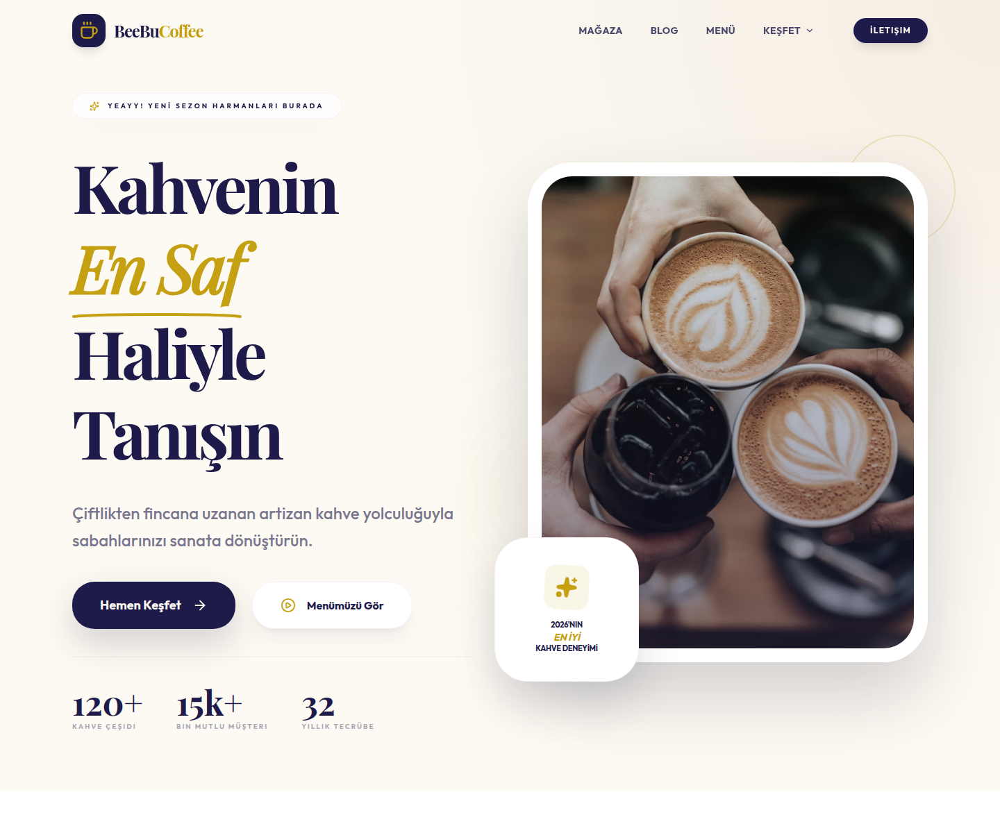

<div align="center">

# BeeBuCoffee

**Kurgusal bir kahve markası için React ve TypeScript ile yazılmış tanıtım ve katalog sitesi.**


[Öne çıkanlar](#öne-çıkanlar) · [Ekran görüntüleri](#ekran-görüntüleri) · [Kurulum](#kurulum-ve-çalıştırma) · [Sayfalar](#sayfalar) · [Klasör yapısı](#klasör-yapısı)



</div>

BeeBuCoffee, butik bir kahve markasının web sitesini canlandıran tek sayfalı bir ön yüz uygulamasıdır. Ziyaretçi ürün kataloğunu, kafe menüsünü, blog yazılarını, şubeleri, kampanyaları ve etkinlikleri gezebilir. React 19, TypeScript, Vite 6 ve Tailwind CSS 4 ile yazıldı; içerik yerel TypeScript veri dosyalarından gelir, arka uç yoktur.

BeeBuCoffee kurgusal bir markadır; ürünler, fiyatlar, şubeler ve iletişim bilgileri örnek veridir.

Canlı sürüm: https://coffee-landing-ss46.vercel.app/

## Öne çıkanlar

- **Ana sayfa:** karşılama bölümü, görünür olunca sayan istatistik sayaçları, marka tarihçesi ve en çok sevilen ürünler.
- **Mağaza:** 8 ürünlük katalog; ada ve açıklamaya göre arama, kahve, termos ve aksesuar filtreleri.
- **Ürün detayı:** her ürün için fiyat ve açıklama sayfası, altında dört ürünlük öneri listesi.
- **Menü:** ürünler sıcak kahveler, soğuk kahveler ve fırın ürünleri başlıklarında listelenir.
- **Blog:** üç yazı; her yazı kendi adresinde (`/blog/:slug`) açılır, sonunda diğer yazılar önerilir.
- **Şubeler:** 7 şehirlik şube listesi; seçilen şube Google Maps iframe gömmesiyle haritada gösterilir.
- **Kampanyalar ve etkinlikler:** üç kampanya kartı; üç etkinlik için liste ve detay sayfası (tarih, yer, kapasite, ücret).
- **İletişim:** telefon, e-posta ve sosyal medya kartları ile genel merkez haritası.
- **Gezinme:** kaydırınca arka planı değişen sabit üst menü, "Keşfet" açılır menüsü ve dar ekranlar için mobil menü.
- **Animasyon:** Motion ile sayfa girişi, kaydırma ve filtre geçişi animasyonları.
- **Tema:** Tailwind CSS 4 `@theme` bloğunda tanımlı indigo, altın ve krem renkleri; Outfit ve Playfair Display yazı tipleri.

## Ekran görüntüleri

<table>
  <tr>
    <td width="50%"></td>
    <td width="50%"></td>
  </tr>
  <tr>
    <td align="center">Mağaza: arama kutusu, kategori filtreleri ve ürün kartları</td>
    <td align="center">Blog: yazı kartları</td>
  </tr>
</table>

Üstteki büyük görsel: ana sayfanın karşılama bölümü.

## Gereksinimler

- Node.js 20.19 ve üzeri ya da 22.12 ve üzeri, npm ile birlikte (`package-lock.json` içindeki `@vitejs/plugin-react` paketinin `engines` alanına göre).
- İnternet bağlantısı: ürün görselleri Unsplash'ten, yazı tipleri Google Fonts'tan, harita Google Maps'ten yüklenir.

`.env` dosyası gerekmez. `src/` altındaki kod hiçbir ortam değişkenini okumaz.

## Kurulum ve çalıştırma

```bash
git clone https://github.com/ismailarat56/coffee-landing.git
cd coffee-landing
npm install
npm run dev
```

Geliştirme sunucusu `http://localhost:3000` adresinde açılır.

Diğer komutlar:

| Komut | İşlev |
|---|---|
| `npm run build` | üretim derlemesini `dist/` klasörüne yazar |
| `npm run preview` | derlenmiş sürümü yerelde sunar |
| `npm run lint` | TypeScript tür denetimi yapar (`tsc --noEmit`) |
| `npm run clean` | `dist` klasörünü ve varsa `server.js` dosyasını siler (`rm -rf` kullanır) |

## Sayfalar

Rotalar `src/App.tsx` içinde React Router DOM 7 ile tanımlıdır.

| Adres | Sayfa |
|---|---|
| `/` | Ana sayfa |
| `/shop` | Mağaza: arama ve kategori filtresi |
| `/product/:id` | Ürün detayı |
| `/menu` | Kafe menüsü |
| `/blog` | Blog yazıları |
| `/blog/:slug` | Blog yazısı |
| `/explore` | Şubeler ve harita |
| `/campaigns` | Kampanyalar |
| `/events` | Etkinlikler |
| `/event/:id` | Etkinlik detayı |
| `/contact` | İletişim |
| `/register` | Müşteri kayıt formu |

## İçerik verisi

Sitedeki içerik koda gömülü dizilerden okunur:

- `src/data/mockData.ts`: ürünler (`PRODUCTS`), şubeler (`BRANCHES`) ve etkinlikler (`EVENTS`).
- `src/data/blogData.ts`: blog yazıları (`BLOG_POSTS`).
- `src/pages/CampaignsPage.tsx`: kampanyalar, sayfa dosyasının içinde.

Yeni bir ürün ya da şube eklemek için ilgili diziye bir öğe eklemek yeterlidir. Ürün ve şube tipleri `src/types.ts` dosyasındadır.

## Klasör yapısı

```
index.html               Vite giriş sayfası
vite.config.ts           Vite ayarları (React ve Tailwind eklentileri)
public/screenshots/      bu README'deki ekran görüntüleri
src/
  main.tsx               uygulamanın başlangıç noktası
  App.tsx                rota tanımları
  index.css              Tailwind teması: renkler ve yazı tipleri
  types.ts               Product ve Branch tipleri
  lib/utils.ts           cn() sınıf birleştirme yardımcısı
  data/                  ürün, şube, etkinlik ve blog verisi
  components/layout/     Header ve Footer
  components/maps/       BranchGoogleMap (şube haritası)
  components/ui/         ProductCard
  pages/                 12 sayfa bileşeni
```

## Bilinen eksikler

- Sepet, ödeme ve sipariş akışı yok; mağaza yalnızca katalog olarak çalışır.
- Kayıt formu (`/register`) hiçbir yere veri göndermez. Kampanya sayfasındaki e-bülten formunun giriş alanı yok.
- Sosyal medya, gizlilik politikası ve KVKK bağlantıları yer tutucudur (`href="#"`).
- `.env.example` dosyasındaki değişkenler ile `@google/genai`, `express` ve `dotenv` bağımlılıkları `src/` altındaki kodda kullanılmaz.
- Otomatik test yok; tek denetim `npm run lint` ile yapılan tür denetimidir.

## Lisans

Kod [MIT lisansı](LICENSE) ile sunulur.

`src/App.tsx` dosyası AI Studio şablonundan gelir ve kendi başlığındaki Apache-2.0 bildirimini taşır.
