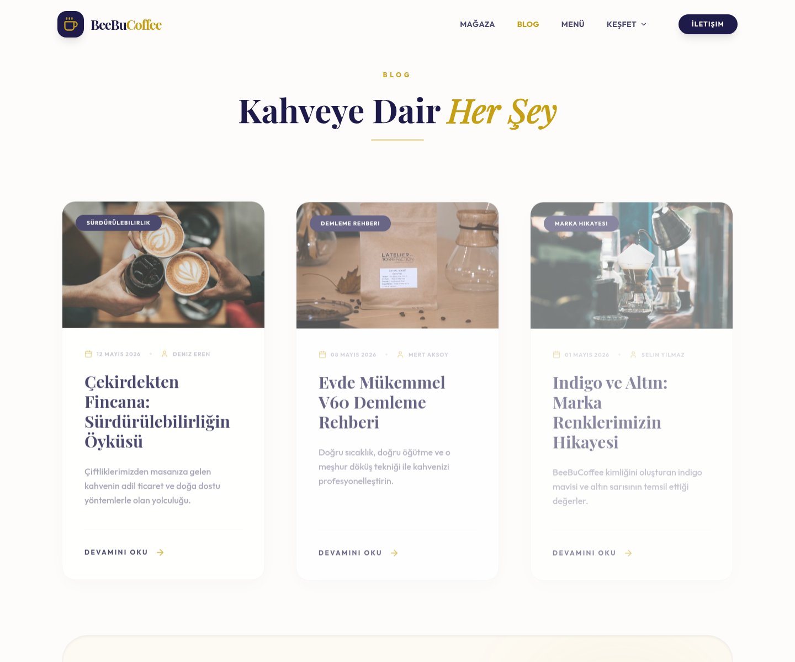

# BeeBuCoffee - Artizan Kahve Deneyimi

BeeBuCoffee, "Çiftlikten Fincana" mottosuyla yola çıkan, modern kahve tutkunları için tasarlanmış, estetik ve kullanıcı dostu bir landing page / e-ticaret platformu prototipidir.

---

## Proje Hakkında

Bu proje, butik bir kahve markasının dijital kimliğini oluşturmak amacıyla geliştirilmiştir. Kullanıcıların ürünleri inceleyebileceği, blog yazılarını okuyabileceği, şubeleri harita üzerinden keşfedebileceği ve etkinlikleri takip edebileceği kapsamlı bir web uygulamasıdır.

## Kullanılan Teknolojiler

Proje, modern web teknolojileri ve kütüphaneleri kullanılarak inşa edilmiştir:

*   **Prerequisites:** Node.js
*   **Frontend:** React 19 (TypeScript)
*   **Build Tool:** Vite
*   **Styling:** Tailwind CSS 4
*   **Animations:** Framer Motion
*   **Icons:** Lucide React
*   **Routing:** React Router 7
*   **Maps:** Google Maps iframe embed
*

## Proje Özellikleri

*   **Responsive Tasarım:** Tüm cihazlarda uyumlu görünüm.
*   **Dinamik Blog Sistemi:** SEO dostu slug yapısına sahip blog detay sayfaları.
*   **Ürün Katalogu:** Kategorize edilmiş ürünler, fiyatlandırma ve detaylı kart yapısı.
*   **İnteraktif Şubeler:** Google Maps embed üzerinde şube lokasyonları.
*   **Etkinlik Yönetimi:** Workshop ve konser gibi etkinliklerin listelenmesi.
*   **Premium Animasyonlar:** Scroll ve hover efektleriyle zenginleştirilmiş kullanıcı deneyimi.

## Sayfa ve Modül Açıklamaları

*   **Ana Sayfa (Home):** Markanın vizyonunu, favori ürünleri ve hikayeyi özetleyen etkileyici giriş.
*   **Menü (Menu):** Sıcak/soğuk kahveler ve fırın ürünlerinin kategorize edildiği dijital menü.
*   **Mağaza (Shop):** Çekirdek kahveler ve aksesuarların bulunduğu alışveriş alanı.
*   **Blog:** Kahve kültürüne dair makalelerin listelendiği içerik platformu.
*   **Şubeler (Explore):** Google Maps embed üzerinden şube bilgilerine erişim.
*   **İletişim (Contact):** Sosyal medya bağlantıları, genel merkez bilgileri ve iletişim kanalları.

## Ekran Görüntüleri

| Ana Sayfa | Mağaza | Blog |
| :--- | :--- | :--- |
|  |  |  |

## GitHub Repo Bilgisi

*   **Repo URL:** [https://github.com/ismailarat56/coffee-landing](https://github.com/ismailarat56/coffee-landing)
*   **Lisans:** Apache-2.0

## Geliştirici Notları

*   Projede **Tailwind CSS 4** kullanılarak stil dosyaları sade tutulmuştur.
*   Kod yapısı **Component-Based Architecture** prensiplerine uygun şekilde kurgulanmıştır.
*   Tipografide **Indigo** ve **Altın** renklerinin kontrastı, markanın premium algısını güçlendirmek için tercih edilmiştir.

---

*BeeBuCoffee - Her yudumda bir sanat.*
